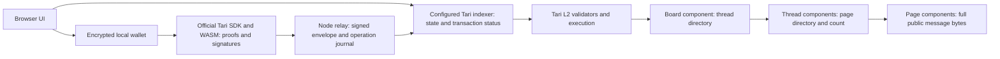

# Hauntboard and Tari L2

Source review: October 8, 2026. This guide describes the current working tree, including uncommitted GUI changes. Deployment statements below refer to saved evidence, not a new live verification.

## What the app does

Hauntboard is a public message board with General, Tari and Politics forums, browser wallet creation/recovery, reviewed posting fees and persistent threads/replies. Tari Ootle, Tari's L2 execution platform, is the application's content store and transaction engine. Full public messages live in component state rather than an application content database. The browser supplies the interface and wallet; a Node companion supplies configuration, reads and a durable transaction relay.

The earlier Hauntbox application under `apps/` is a different design: encrypted submissions remain off chain, while contracts anchor receipt digests and an operator processes rewards. Historical Hauntboard schema 3 supports sealed envelopes and local demo tips. The current schema-4 public board accepts public threads only; those historical features are not current public onboarding capabilities.

## Architecture and storage

| Data | Location | Consequence |
|---|---|---|
| Board title and thread directory | L2 board component | Shared chain state; capacity is 128 threads |
| Thread title, ID, page addresses and post count | L2 thread component | Stable reply numbering across pages |
| Message payload, logical nonce, parent index and consensus epoch | L2 page component | Public, persistent bytes; no accepted-post edit/delete method |
| Forum category | Public opening-post payload | Application convention within a shared board directory |
| Seed, owner/view keys and output ledger | Encrypted browser IndexedDB | Device credential protects local access; operator receives no seed |
| Signed submissions and reconciliation metadata | Browser pending-operation storage and relay journal | Recovery from lost acknowledgements depends on preserving operation state |
| Historical sealed-thread keys | Local browser/invitation backups | Schema-3 compatibility only; not schema-4 secrecy |

An epoch is chain metadata, not a precise wall-clock timestamp. Browser hiding affects only that browser. Retaining relay volumes does not replace preserving chain data or wallet recovery credentials.

## Contract implementation

[`template-public/src/lib.rs`](../template-public/src/lib.rs) defines one Rust `#[template]` with board, thread and page roles. The WASM template defines behavior; `Hauntboard::new(title)` creates a board component. `create_thread(title, mode, uid, payload)` creates a thread and its first page. `append(nonce, parent, payload)` appends replies, creating pages as required.

Schema 4 requires public mode `0`, 16-byte thread/post IDs, titles of 1–80 bytes, and payloads of 1–4,096 bytes. Each page holds 16 posts, each thread up to 2,048 posts. These are byte limits, which differ from Unicode character counts. Page writes use `caller_component` access rules restricted to their owning thread. Board/thread posting and reading are public; the contract has no owner and no author public-key field. It does not prove a poster's identity or provide administrative moderation credentials.

Opening-thread retries compare ID, title, mode and exact first payload. Reply IDs encode a little-endian page hint in their first four bytes and 96 random bits afterward. Exact nonce/parent/payload retries return the existing post index; conflicting reuse fails. A stale page hint requires refreshing and reviewing the operation. Preserve this protocol when extending pagination: retries must remain valid after rollover, and cross-component reads must stay bounded.

## A post from review to display

1. The browser loads the pinned network/reset profile and verified board/thread state. Reading does not require unlocking a wallet.
2. The user prepares public content and reviews the transaction and maximum fee. The client builds the contract call and appropriate versioned inputs.
3. For the native stealth posting profile, the wallet verifies and locally decrypts an owned native output. Official Tari WASM creates commitments, proofs and one-time spend authorization.
4. The fee program consumes that output and pays the public fee from a bucket. A fresh ephemeral signer is used; this path omits the persistent wallet-owner transaction signature and named account input. The contract call runs as the main instructions.
5. The browser seals the transaction and retains its identity and exact envelope. The companion relays signed bytes and records a durable claim before submission.
6. The client resolves finalized acceptance or rejection, then waits for indexing and refreshes the thread. A submission acknowledgement alone is not final execution acceptance.

[`web/stealth-fee.mjs`](../web/stealth-fee.mjs) contains a version-specific SDK adaptation: move the hydrated stealth program into `fee_instructions` before generating any transaction signatures. Fee and main instruction workspaces differ. Reordering after signing invalidates authorization.

[`lib/relay.mjs`](../lib/relay.mjs) binds operation identity to an envelope fingerprint, uses exclusive journal creation and refuses changed bytes for an existing operation. Unknown outcomes require lookup/reconciliation. Provider failure, missing transaction data or Pending do not establish rejection. Do not issue a replacement spend just because a request timed out.

## Wallets, funding and recovery

[`web/browser-wallet.mjs`](../web/browser-wallet.mjs) manages browser wallet lifecycle. [`wallet-recovery/`](../wallet-recovery/README.md) wraps native Rust CipherSeed v2 decoding/creation and Tari owner/view-key derivation. New onboarding uses 24 words and a six-digit device PIN; retained password wallets have migration support. The device PIN is distinct from the optional original seed passphrase. Native recovery also depends on the original account index and the selected network/reset.

Recovery derives the standard account address and verifies ownership before including revealed account funds. Balance sync also discovers native stealth outputs and decrypts ownership locally. Total holdings and posting-ready funds are different: an imported account can hold revealed TARI while lacking suitable private posting outputs. The current preparation flow converts 10 test TARI into four 2.5-TARI outputs after fee review; this is app policy, not a Tari protocol denomination.

Posting change is quarantined, including through an encrypted native memo, because using it for the next post links the output graph. Scanning is bounded and may require subsequent syncs; the encrypted ledger has a finite capacity. A seed restores keys and discoverable funds, not another device's pending intent. Faucet availability depends on configuration, funding and provider availability; it is not guaranteed.

## Privacy and trust boundaries

Public post text, titles, reply relationships and epochs are readable chain data. Removing an author field and persistent owner signature reduces stable wallet linkage; it does not make messages anonymous. Fees, input ancestry, spent-output graphs, timing, funding behavior and network connections remain observable. The current fee path pays the reviewed allowance; do not assume an unused allowance is refunded.

The browser relies on configured indexers and their `verified` responses. It does not independently verify validator consensus proofs. An indexer can lag or omit outputs, affecting display and balance discovery. The relay is a single-host availability dependency with finite concurrency and journal capacity. Independent clients/providers improve application recovery, but the one-validator localnet does not demonstrate decentralized public consensus.

Seeds, PINs, passphrases and private keys stay local. Never include them in diagnostics or evidence. Wallet APIs require HTTPS or localhost secure contexts. The source supports localnet byte 16 and Esmeralda byte 38 with an explicit reset identity; mainnet is disabled in this application.

## Compatibility and verification

These are repository pins, not recommendations for the newest upstream release:

| Layer | Source pin |
|---|---|
| Public template library | `tari_template_lib = 0.34.0` |
| Native template test harness | `tari_template_test_tooling = 0.45.0` |
| Browser Ootle/indexer/secret-key-wallet packages | `0.7.0` |
| Browser Tari WASM | `0.43.0` |
| Native recovery libraries | `tari_common_types 6.0.1`, wallet crypto `0.45.0` |

The libraries intentionally have different version numbers. Check the manifests, lockfiles, engine behavior and actual target providers rather than matching version strings or adopting older skill examples. All project toolchains run in containers; sibling Tari source snapshots are read-only references.

Recorded October 8 deployment evidence identifies release `0.6.14-square-pin` on the existing Ubuntu/Esmeralda beta, retained board and operation volume, and public HTTPS asset/PIN checks. Those checks submitted no chain writes. See [deployment evidence](../evidence/newgui-deployment.md), [imported balances](../evidence/imported-account-balance.md), [posting preparation](../evidence/posting-preparation.md), and [poster privacy investigation](../POSTER_PRIVACY.md). Older README and release sections saying public deployment/scanning are unimplemented are historical and conflict with newer records. Neither a GUI deployment nor recovered balance alone certifies public posting privacy or full release acceptance.

For changes, select the relevant gates: native contract tests for access/limits/retry behavior; transaction-identity and relay-reconciliation tests for unknown outcomes; output-ledger and seed-wallet tests for recovery; Chromium/Firefox browser tests for wallet lifecycle; isolated funded-chain tests for real fee execution and reads. GUI mocks are useful UI evidence, not chain evidence. Recheck public compatibility only against the authorized target and spending budget.

## Extending the app

Start with the desired chain invariant, then update the template, state decoder, transaction builder and browser flow together. New schemas need a fresh published template/component and explicit compatibility handling for historical boards. Package source/WASM hashes and record actual confirmed addresses; template publication and component creation are separate operations. Preserve old wallets, boards and volumes. Never treat a frontend-only update as a contract migration.

Useful entry points: [`lib/state.mjs`](../lib/state.mjs), [`lib/chain.mjs`](../lib/chain.mjs), [`web/network-profile.mjs`](../web/network-profile.mjs), [`web/output-ledger.mjs`](../web/output-ledger.mjs), [`web/transaction-identity.mjs`](../web/transaction-identity.mjs), [`server.mjs`](../server.mjs), and [contract review](smart-contract-review.md).

Protocol references: [official Tari Ootle documentation](https://ootle.tari.com/) covers templates, component execution, assets, privacy, transactions and testnet workflows. Verify current APIs there and against the exact released sources used by the target deployment.
